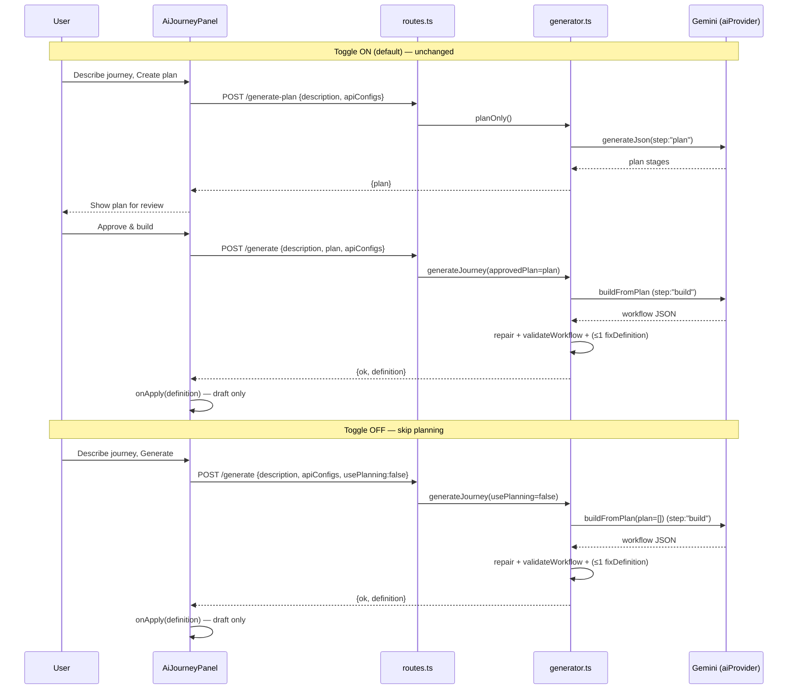
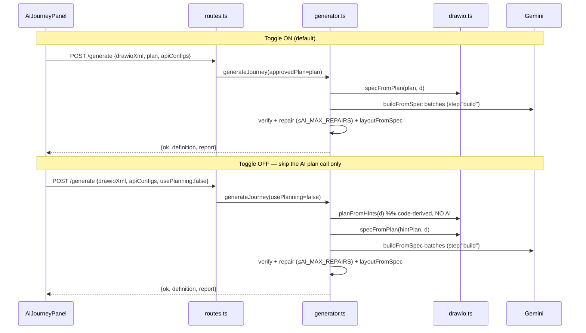

# Use AI Planning Toggle — Implementation Document

## 1. Title and Objective

**Feature:** Add a frontend toggle labelled **"Use AI Planning"** to the AI Journey Generator in the WhatsApp Chatbot Builder.

**Objective:** Let the user choose between two behaviours for AI generation:

- **Toggle ON (default):** the existing two‑phase *Plan → review → Approve & Build* workflow, unchanged.
- **Toggle OFF:** skip the separate AI planning stage entirely — no planning endpoint call, no plan‑review screen — and generate the workflow directly with Gemini, still running the existing validation, repair and normalization, and still applying the result to the canvas as a **draft only**.

This document is **design only**. No application source was modified. See §19 for the explicit confirmation.

> **Legend used throughout:** ✅ **Verified** = read directly from the source. 🔧 **Proposed** = a recommended change that does not yet exist. ❓ **Open question** = the code does not answer it.

---

## 2. Executive Summary

The AI generator today is a two‑phase, agentic pipeline. The frontend (`AiJourneyPanel.tsx`) first calls `POST /workflow/generate-plan` (→ `planOnly()` → `planJourney()`), shows the proposed stages, and only after the user approves calls `POST /workflow/generate` (→ `generateJourney()`), which builds from the approved plan, validates, repairs, applies `ensureSingleStart()`, and returns a draft definition for the canvas. ✅

A key verified fact shapes the whole design: **`generateJourney()` already works without an approved plan.** When `approvedPlan` is empty it internally calls `planJourney()` to make one. So "planning" is not a hard dependency of the *endpoint* — it is a step *inside* the generator. ✅

Therefore the smallest, safest change is:

- 🔧 **No new endpoint.** Extend the two existing routes with an optional boolean `usePlanning` (default `true`).
- 🔧 **Frontend:** add the toggle; when OFF, bypass `createPlan()` / the review phase and call `POST /workflow/generate` directly with `usePlanning: false` and **no `plan`**.
- 🔧 **Backend generator:** thread `usePlanning` into `generateJourney()`. When `false`, do **not** call `planJourney()` / `planFromDiagram()`; build directly.
  - **Description / edit mode:** build with an empty plan (description + the existing rich context blocks are enough — `buildFromPlan()` already tolerates an empty plan).
  - **Diagram mode:** skip only the *AI* `planFromDiagram()` call; still run the deterministic `specFromPlan()` (needed for stable IDs, coverage, layout and fidelity) by feeding it a plan **derived in code from the parser's `suggested` hints** rather than from the AI. Batching, verification, repair and layout are preserved.

**Cost impact:** the toggle removes exactly **one Gemini "plan" call per generation** (for diagram mode, this is also the most expensive single call — it uses `AI_THINKING_PLAN = "medium"` ✅). Build, repair and verification calls are unaffected and may still run. Direct generation still uses Gemini; it does **not** eliminate all AI calls. (§15.)

The draft‑only, no‑auto‑save / no‑publish behaviour is preserved end‑to‑end. ✅ (The routes never save or publish on generate; the frontend `onApply()` only drops nodes on the canvas.)

---

## 3. Verified Current Architecture

### 3.1 Files inspected

| File | Role |
|---|---|
| `backend/src/modules/workflows/generator.ts` | ✅ The AI pipeline: `planOnly`, `generateJourney`, `planJourney`, `planFromDiagram`, `buildFromPlan`, `buildFromSpec`, `fixBlocks`, `fixDefinition`, `patchBuild`, `generateFromDiagram`, `verify`, `makeEditContext`, plan cache, `DIAGRAM_LIMITS`, prompts (`NODE_CATALOG`, `RULES`). |
| `backend/src/modules/workflows/routes.ts` | ✅ Routes under `/api/chatbots/:chatbotId/workflow`: `generate-plan`, `generate`, plus draft/publish/versions/test/ping. Zod `generateSchema`. |
| `backend/src/modules/runtime/aiProvider.ts` | ✅ Gemini client `callGemini` + `generateJson`; `AiStep` tags; thinking config; `onAiUsage` usage logging. |
| `backend/src/modules/workflows/drawio.ts` | ✅ `parseDrawio`, `describeDiagram`, `CLASSIFY_GUIDE`, `BUILD_RULES`, `specFromPlan`, `describeSpec`, `layoutFromSpec`, `suggestType` (the keyword hinting used in `shape.suggested`). |
| `backend/src/modules/workflows/fidelity.ts` | ✅ `enforceSpec`, `checkFidelity`, `simulateBranches`, `buildReport`, `repairableProblems`, `failedCount`. |
| `backend/src/modules/workflows/capabilities.ts` | ✅ `CAPABILITIES`, `BUILDER_TYPES`, `toBuilderType`, `toBuilderNode`. |
| `backend/src/modules/workflows/validator.ts` | ✅ `validateWorkflow` — the publish‑time rules reused by fidelity. |
| `backend/src/modules/workflows/service.ts` | ✅ Draft/version persistence (not touched by generate). |
| `backend/src/infra/config.ts` | ✅ `GEMINI_MODEL`, `AI_THINKING_*`, `AI_BUILD_CONCURRENCY`, `AI_MAX_REPAIRS`. |
| `backend/src/app.ts` | ✅ `express.json({ limit: "6mb" })` — requests are **JSON**, not multipart. |
| `frontend/src/app/chatbots/[id]/builder/AiJourneyPanel.tsx` | ✅ The generator UI: phases, `createPlan()`, `buildApproved()`, mode toggle, payloads. |
| `backend/scripts/benchmark-ai.ts` | ✅ Real‑pipeline benchmark that already consumes `onAiUsage`. |

### 3.2 Node catalog (verified)

`BUILDER_TYPES` (what the AI may emit): `START, SEND_MESSAGE, ASK_INPUT, LIST, CONDITION, AI_RESPONSE, SET_VARIABLE, TRANSFORM, API_REQUEST, WAIT`. ✅
`VALIDATE` and `BUTTONS` still exist in `CAPABILITIES`/runtime but are **not** builder types; `toBuilderNode()`/`toBuilderType()` map them to `CONDITION` / `SEND_MESSAGE`. ✅

### 3.3 Guardrails (verified)

- Exactly one `START`; `ensureSingleStart()` is applied at the end of `repair()`, `buildFromSpec()` and `generateFromDiagram()`. ✅
- `RULES` prompt text enforces: one START with id `"start"`, reachability, no edge into START, CONDITION/API_REQUEST have `true`/`else` handles, button/row `sourceHandle` equals the option id, unique ids, declared variables. ✅
- `validateWorkflow()` is the publish‑time check (one START, required fields per type, no dangling/orphan/into‑START edges, both branches for CONDITION/VALIDATE, every LIST row / reply button connected). ✅
- Diagram mode additionally verifies against the source via `enforceSpec` + `checkFidelity` + `simulateBranches`, and produces a `FidelityReport`. ✅
- `generate` returns `{ ok, definition, plan, warnings, report, reportId }`; a 422 is returned only for diagram **size** limits and unreadable diagrams, not for invalid output (invalid output comes back as `ok:false` with `errors` + the definition). ✅
- **Draft‑only:** neither route saves or publishes; the canvas apply is `onApply(definition)`. ✅

---

## 4. Existing Behaviour by Mode

### 4.1 Description mode ✅ (matches the brief, with clarifications)

1. User types a description in `AiJourneyPanel` (create mode).
2. `createPlan()` → `POST /workflow/generate-plan` with `{ description, drawioXml?, apiConfigs }`.
3. Backend `planOnly()` → `planJourney()` → (no diagram, no edit) builds a plan prompt from `NODE_CATALOG` + `apiConfigsBlock()` and calls `generateJson(p, { step: "plan" })`. ✅
4. Stages are shown for review.
5. User clicks **Approve & build** → `buildApproved()` → `POST /workflow/generate` with `{ description, drawioXml?, sourceName?, plan, apiConfigs }`.
6. Backend `generateJourney()`: `approvedPlan` is present → `buildFromPlan(description, plan, undefined, apiConfigs)` → `repair()` → `relevantErrors()` → at most **one** targeted `fixDefinition()` pass if errors remain. ✅
7. `ensureSingleStart()` is inside `repair()`. Result applied to canvas.

> **Clarification vs. the brief:** the brief names `buildFromPlan()` for description mode — ✅ confirmed. The old AI self‑review pass was removed; validation is `validateWorkflow()` via `relevantErrors()` plus one `fixDefinition()` repair. ✅

### 4.2 Diagram mode ✅ (matches the brief, with important nuance)

1. User attaches a `.drawio`/`.xml` file; the browser reads it to a string and sends `drawioXml`. ✅ (JSON body, not multipart.)
2. `planOnly()`/`generateJourney()` call `loadDiagram()` → `parseDrawio()` → shapes + connections, with `suggested` type hints from `suggestType()`. ✅
3. Planning AI (`planFromDiagram()`) classifies each shape (or `SKIP`), using `CLASSIFY_GUIDE` + `describeDiagram()`. ✅
4. The AI plan is normalized by `specFromPlan(plan, d, BUILDER_TYPES)` → a `FlowSpec` with stable node ids, exactly one START, every shape accounted for, over‑merge guards, and reconnection through merged/skipped shapes. ✅
5. Frontend shows the plan + "not bot steps (left out)".
6. On approval, `generateFromDiagram()` runs: `buildFromSpec()` (batched, `BUILD_BATCH_SIZE = 12`, `BUILD_CONCURRENCY = AI_BUILD_CONCURRENCY`, truncation → split‑and‑retry), then `verify()` (= `enforceSpec` + `checkFidelity` + `simulateBranches`), then up to `AI_MAX_REPAIRS` escalating `fixBlocks()` passes, then `layoutFromSpec()` + `meta.layout = "drawio"`, then `buildReport()`. ✅
7. Diagram fidelity report returned; original layout retained via `meta.layout === "drawio"`. ✅

> **Nuance that drives the OFF design:** in diagram mode the **plan** feeds `specFromPlan()`, and the `spec` — not the raw plan — is what drives building, verification, repair and layout. `specFromPlan()` is **deterministic** and already "re‑adds anything missing" from the parser's hints. So the *AI* plan is one input to the spec; it is not structurally mandatory. (§10.)

### 4.3 Edit mode ✅ — does NOT require a separate planning phase

- `makeEditContext()` builds `{ existing, editInstruction, anchorNodeId }`. ✅
- `generateJourney()` with `edit` set: if no `approvedPlan`, it *tries* `planJourney(description, null, edit, ...)` (best‑effort; failures fall back to `plan = []`), then `patchBuild(edit, plan, …)`. ✅
- `patchBuild()` preserves existing node ids (so the frontend keeps positions), rewires around inserts/deletes, and returns the complete updated workflow. ✅
- **Verified:** edit mode *can* run with an empty plan already (planning is best‑effort). The current UI still routes edit through plan→review→approve, but the generator does not strictly need it. 🔧 Per the brief, **do not add planning into edit mode where it isn't needed**; the toggle should simply control whether the edit plan step runs, defaulting to the current behaviour. (§11.)

---

## 5. Proposed Toggle Behaviour

A single boolean **`usePlanning`**, default **`true`**, surfaced as the "Use AI Planning" toggle.

### Toggle ON (default) 🔧 = unchanged behaviour ✅

- Keep `generate-plan`, the plan‑review screen and `Approve & build`.
- Keep `generateJourney()`'s existing path (approved plan → build → validate → repair).
- No behavioural change whatsoever.

### Toggle OFF 🔧

- The frontend does **not** call `generate-plan` and does **not** render the review phase.
- The frontend calls `POST /workflow/generate` directly with `usePlanning: false` and **omits `plan`**.
- The backend **must not** call `planJourney()` / `planFromDiagram()`.
- Build directly:
  - description/edit: empty plan + description/edit context;
  - diagram: deterministic code‑derived spec (no AI plan call).
- Run the same validation, repair, `ensureSingleStart()`/`layoutFromSpec()` normalization.
- Apply as a **draft**. No auto‑save, no publish.

**Explicitly out of scope** (per brief): no complexity detector, no automatic plan/no‑plan decision, no "lightweight" replacement planning call, no second planning model/provider.

---

## 6. ON and OFF Workflow Sequence Diagrams

### 6.1 Description/Edit mode



### 6.2 Diagram mode



---

## 7. Frontend Implementation Plan — `AiJourneyPanel.tsx`

### 7.1 Where the toggle appears

🔧 In the create/edit input area, above the footer buttons (near the draw.io attach row in create mode). A compact switch labelled **"Use AI Planning"** with a one‑line helper: *"On: review a plan before building. Off: generate directly."* It applies to **all** modes (create‑description, create‑diagram, edit).

### 7.2 State

🔧 `const [usePlanning, setUsePlanning] = useState(true);`

- **Default ON** — matches today's behaviour (the panel subtitle is literally "Plan first, then build" ✅).
- Disable the toggle while `busy` (`phase === "planning" || "building"`).

### 7.3 Persistence ❓/🔧

- The panel currently persists **nothing** across sessions (all `useState`, reset on reload). ✅
- 🔧 **Recommended:** persist the last choice in `localStorage` (e.g. key `ai.usePlanning`) so a user who prefers direct generation isn't reset each session, while the **default remains ON** on first use. This is a small, self‑contained addition consistent with "sensible default based on current UI behaviour". If persistence is considered scope creep, keeping it session‑only (default ON every open) is acceptable. ❓ Product decision.

### 7.4 Control flow

🔧 The primary footer button becomes mode‑aware:

- `usePlanning === true` → unchanged: button reads **"Create plan"** → `createPlan()` → review → **"Approve & build"** → `buildApproved()`.
- `usePlanning === false` → button reads **"Generate"** and calls a new `generateDirect()` that **skips** the planning phase and review entirely.

```ts
// 🔧 Proposed — direct generation, no plan/review phase.
async function generateDirect() {
  // Same per-mode input validation as createPlan().
  if (mode === "edit" && !instruction.trim()) { setError("Describe the change you want to make."); return; }
  if (mode === "create" && !description.trim() && !drawioXml.trim()) {
    setError("Describe the journey or attach a draw.io diagram first."); return;
  }
  if (hasExistingNodes) {
    const ok = await dialog.confirm({ title: "Replace the current flow?", /* …existing copy… */ confirmText: "Replace" });
    if (!ok) return;
  }
  setError(""); setWarnings([]); setPlan([]); setPhase("building");  // NB: no "planning" phase, plan cleared
  try {
    const body: any = mode === "edit"
      ? { editInstruction: instruction, currentDefinition: getCurrentDefinition(), anchorNodeId: anchorNodeId || undefined, usePlanning: false }
      : { description, drawioXml: drawioXml || undefined, sourceName: drawioName ?? undefined,
          apiConfigs: getCurrentDefinition()?.apiConfigs, usePlanning: false };
    const res = await api.post(`/api/chatbots/${chatbotId}/workflow/generate`, body);
    // …identical response handling to buildApproved(): definition guard, report?.status === "failed"
    //   confirm dialog, onApply(definition), onReport(rep), resetAll(), setReport(rep), warnings…
  } catch (err: any) {
    setError(err.response?.data?.error ?? "Build failed. Please try again.");
    setPhase("input");   // OFF mode returns to input (there is no review to return to)
  }
}
```

Key differences from `buildApproved()`:

- **No `plan` field** in the body (prevents the backend reusing a plan — §7.6).
- On error, return to **`input`** (there is no `review` phase in OFF mode).
- The `diagramInfo` "Building N steps…" banner currently requires `diagramInfo` which today is set by `createPlan()`. 🔧 In OFF mode, either (a) omit the step count from the banner, or (b) read it from the `generate` response if we expose it. Simplest: show a generic "Generating…" banner when `diagramInfo` is null. ❓ Minor UX choice.

### 7.5 Loading / success / error states

- 🔧 OFF description/edit: a single `building` phase with a "Generating…" spinner; then success/warnings/report handling identical to `buildApproved()`.
- 🔧 OFF diagram: same `building` phase; the verification `report` and `warnings` are rendered exactly as today.
- The "Proposed plan (N stages)" block and the `review` footer are **not** rendered when `usePlanning === false` (gate on `usePlanning && plan.length > 0`).

### 7.6 Preventing a stale plan (critical) 🔧

- `generateDirect()` calls `setPlan([])` before the request and **never** sends `plan` → the backend cannot reuse a stale plan.
- Switching the toggle OFF should also clear any plan currently on screen: 🔧 `onChange` handler does `setUsePlanning(v); if (!v) { setPlan([]); if (phase === "review") setPhase("input"); }`.
- Switching modes already calls `switchMode()`; 🔧 extend `reset()`/`switchMode()` to also clear `plan` (it already clears via `reset()` in several paths) so a plan from a previous mode cannot leak into a direct generation.

### 7.7 Interaction with modes

- **Create‑description:** OFF sends `{description, apiConfigs, usePlanning:false}`.
- **Create‑diagram:** OFF sends `{description?, drawioXml, sourceName?, apiConfigs, usePlanning:false}`.
- **Edit:** OFF sends `{editInstruction, currentDefinition, anchorNodeId?, usePlanning:false}`. The anchor dropdown and edit UI are unchanged.

### 7.8 Endpoint & payload (derived from code, not invented)

- OFF uses the **existing** `POST /api/chatbots/:chatbotId/workflow/generate` with the existing fields plus `usePlanning: false` and no `plan`. ✅ (All listed fields already exist in `generateSchema`.)
- ON is byte‑for‑byte the current two calls. ✅

---

## 8. Backend Route and Request‑Contract Changes — `routes.ts`

### 8.1 Route strategy 🔧 (recommended: extend, do not add)

- **No new route.** Add an optional `usePlanning: z.boolean().optional().default(true)` to `generateSchema` (shared by `/generate-plan` and `/generate`). ✅ This is backward compatible: existing clients that omit the field get `true` (current behaviour). (§17 edge case: old payloads.)
- `/generate-plan` 🔧 may also accept the field but it is **moot** there — if a client ever calls `generate-plan` it clearly wants a plan. Recommended: ignore `usePlanning` in `generate-plan` (planning is its sole purpose), or reject with 400 only if you want strictness. Simpler to ignore. ❓ Minor.

### 8.2 Receiving / parsing the flag

- Requests are **JSON** (`express.json`, §3.1) — `usePlanning` arrives as a real boolean through Zod. ✅
- **Multipart note (for completeness):** the codebase does **not** use multipart for these routes (the file is sent as the `drawioXml` string in JSON). ✅ *If* multipart were ever introduced, a form field `"false"` is a string, not boolean — it must be coerced (`z.coerce.boolean()` treats `"false"` as `true`, so use an explicit `z.preprocess((v) => v === true || v === "true", z.boolean())`). This is a caveat to record, not a change needed today. ❓/🔧

### 8.3 Routing into the generator

🔧 In the `/generate` handler, pass the flag through:

```ts
// 🔧 Proposed (illustrative) — in POST /generate
const { description, drawioXml, plan, editInstruction, currentDefinition, anchorNodeId, apiConfigs, usePlanning } = parsed.data;
// …existing isEdit / input checks…
const result = await generateJourney(
  description, drawioXml,
  usePlanning ? (plan as any) : undefined,   // never pass a plan when planning is OFF
  editCtx, configs,
  { usePlanning }                            // 🔧 new options arg (see §9)
);
```

### 8.4 Server‑side enforcement (not just frontend) 🔧

- The decision must be enforced **inside `generateJourney()`** (§9), not by trusting the frontend to skip `generate-plan`. Even if a client sends `usePlanning:false` *with* a `plan`, the handler drops the plan (passes `undefined`) and the generator does not call `planJourney()`.

### 8.5 Rejecting malformed / unsupported combos 🔧

- Keep existing input checks (need a description, diagram, or edit instruction — else 400). ✅
- `usePlanning:false` with an empty description **and** no diagram **and** no edit instruction → the existing 400 already covers it. ✅
- `usePlanning:false` together with a `plan` → not an error; the plan is ignored server‑side (documented behaviour). 🔧
- Diagram size limits and unreadable diagrams still return 422 as today (they apply before/independent of planning). ✅

---

## 9. Generator and Direct‑Generation Design — `generator.ts`

🔧 Add an options parameter so the public entry point can skip planning without changing any existing call site's meaning:

```ts
// 🔧 Proposed signature change (append optional opts; default preserves today's behaviour)
export async function generateJourney(
  description: string,
  drawioXml?: string,
  approvedPlan?: PlanStage[],
  edit?: EditContext,
  apiConfigs?: any[],
  opts: { usePlanning?: boolean } = { usePlanning: true },   // 🔧 new
): Promise<GenerateResult>
```

Internal change (illustrative, matching current structure ✅):

```ts
const usePlanning = opts.usePlanning !== false;

let plan: PlanStage[] = Array.isArray(approvedPlan) && approvedPlan.length ? approvedPlan : [];
if (!plan.length && usePlanning) {               // 🔧 only auto-plan when planning is ON
  try { plan = await planJourney(description, useDiagram ? diagram : null, edit, apiConfigs); }
  catch { plan = []; }
}
// When usePlanning === false: plan stays [] and planJourney() is NEVER called.
```

> This is the **minimal, reusable** change. `buildFromPlan()`, `patchBuild()`, `relevantErrors()`, `fixDefinition()` and the whole diagram path already accept an empty/absent plan path — see below.

### 9.1 Direct description generation ✅ (already supported) + 🔧 (optional prompt enrichment)

- `buildFromPlan(description, plan=[], undefined, apiConfigs)` already embeds `NODE_CATALOG` + `RULES` + `apiConfigsBlock()` + the raw user description, and prints the (empty) "APPROVED PLAN" JSON. ✅ It then `repair()`s (unique ids, builder‑only types, `ensureSingleStart`). So **direct description generation needs no new prompt** — it already contains node schemas, config rules, branch/connection rules, API configs, the "exactly one START / valid connections / reachable nodes" rules, and the "output strict JSON" instruction. ✅
- 🔧 **Optional improvement:** when `plan` is empty, the line `APPROVED PLAN (follow it stage by stage): []` is slightly misleading to the model. Recommend a tiny conditional in `buildFromPlan()`: if `plan.length === 0`, replace that block with *"Design the full journey yourself from the description below; there is no pre‑approved plan."* This is a one‑branch prompt tweak, not a rewrite, and only affects the no‑plan path. ❓ Whether to add it is a quality tuning choice; measure with the benchmark (§15).
- **Does it bypass `buildFromPlan()`?** No need to. `buildFromPlan()` does **not** require a non‑empty plan — it tolerates `[]`. Reusing it is the smallest change. 🔧 If prompt clarity matters, the conditional above keeps it reusable.

### 9.2 Direct diagram generation 🔧 (skip the AI plan call, keep the spec)

The crucial design point (§4.2 nuance): diagram building is driven by the **`FlowSpec`** from `specFromPlan()`, which is **deterministic** and already classifies unmentioned shapes from the parser's `suggested` hints. ✅ So OFF mode must still produce a spec — it just must not pay for the AI `planFromDiagram()` call.

🔧 Introduce a tiny code‑only helper that turns the parsed diagram into a "plan" using the hints the parser already computed, then feed it through the *existing* `specFromPlan()`:

```ts
// 🔧 Proposed — derive a plan from the parser's own hints, no AI.
function planFromHints(d: ParsedDiagram): PlanStage[] {
  return d.shapes
    .filter((s) => !s.isEnd)                         // END shapes aren't nodes (same as AI path)
    .map((s, i) => ({
      step: i + 1,
      title: s.label.slice(0, 60),
      // s.suggested is like "SEND_MESSAGE with buttons" / "CONDITION (validity check)" /
      // "USER ACTION …"/"SYSTEM EVENT …"/"NOTE …" — take the leading token;
      // non-types (USER/SYSTEM/NOTE/UNCLEAR) fall through to specFromPlan's own handling.
      nodeType: s.isStart ? "START" : s.suggested.split(/[ (]/)[0],
      detail: "",
      sourceIds: [s.id],
    }));
}
```

Then in `generateJourney()` diagram branch, when `usePlanning === false`:

```ts
// 🔧 inside generateFromDiagram path selection
const planForSpec = usePlanning ? plan : (plan.length ? plan : planFromHints(diagram!));
return generateFromDiagram(description, planForSpec, diagram!, apiConfigs, warnings);
```

What this preserves (all ✅ via the unchanged downstream):

- **Source shapes & connections, stable ids:** `specFromPlan()` assigns `start`/`d_<id>` ids and reconnects through merges/skips exactly as in the AI path. ✅
- **Shape‑to‑node mapping:** uses the same `suggestType()` hints the AI path falls back to for unmentioned shapes. ✅
- **SKIP / non‑bot shapes:** `USER ACTION`, `SYSTEM EVENT`, `NOTE`, `UNCLEAR` tokens aren't in `BUILDER_TYPES`; `specFromPlan()` already folds user/system/notes and re‑classifies or skips them, and its over‑merge guard splits genuinely separate steps back out. ✅ (Fidelity may be lower than the AI plan — recorded as a known limitation, §17.)
- **Branches (true/false, options):** derived from the diagram edges + labels in `specFromPlan()` and verified in `checkFidelity`/`simulateBranches`. ✅
- **Labels / text fidelity:** the AI plan supplies `text`/`textSource`/`variable` hints that `enforceSpec()` uses to restore exact text. With no AI plan, these are absent, so `enforceSpec()` cannot know which shape text is *verbatim*; the builder writes text from `describeSpec()` and labels. 🔧 This is the main fidelity trade‑off of OFF diagram mode — document it and surface it in the report/warnings. (§17, ❓ acceptable‑quality decision.)
- **Batching:** `buildFromSpec()` unchanged — `BUILD_BATCH_SIZE`, `BUILD_CONCURRENCY`, truncation split‑and‑retry. ✅
- **Verification & report, repair, layout:** `verify()`, `fixBlocks()` up to `AI_MAX_REPAIRS`, `layoutFromSpec()`, `meta.layout = "drawio"`, `buildReport()` all unchanged. ✅

> **Do not** try to collapse classification + building into one Gemini request for large diagrams — batching exists precisely because one reply has an output limit (`AI_OUTPUT_TRUNCATED`). The OFF path keeps batching. ✅

### 9.3 Plan cache implications (investigated) ✅

- The cache (`planCache`, TTL 1h, max 30, keyed by SHA‑256 of `[description, shapes, edges, apiConfig names]`) lives **inside `planJourney()`** and only applies to **diagram, non‑edit** plans. ✅
- When `usePlanning === false`, `planJourney()` is never called, so the cache is **neither read nor written** — correct and expected. There is no correctness risk; the only "loss" is that a subsequent ON generation won't find an OFF run in the cache (OFF never produced an AI plan to cache). ✅ No change to the cache is needed.

### 9.4 Edit mode 🔧 (minimal)

- `generateJourney()` already does best‑effort planning for edits, then `patchBuild()`. ✅
- With `usePlanning === false`: skip the plan attempt (per §9 change) and call `patchBuild(edit, [] , …)`. `patchBuild()` embeds the full current workflow + the change instruction + patch rules and does not require a plan. ✅ Node ids/positions are preserved exactly as today. No other change.

### 9.5 Gemini provider ✅ (no change)

- Direct generation reuses `generateJson(prompt, { step: "build" | "patch" })` → `callGemini()`. ✅
- Thinking level, JSON response mode, fence stripping, `MAX_TOKENS` → `AI_OUTPUT_TRUNCATED`, 400‑thinking fallback, and `onAiUsage()` logging are all reused unchanged. ✅
- **No new provider, no duplicate integration.** (§Constraints.)

---

## 10. Diagram Mode Considerations (summary)

| Concern | ON | OFF |
|---|---|---|
| Parse XML (`parseDrawio`) | ✅ | ✅ (identical) |
| Shape classification | AI `planFromDiagram` + `specFromPlan` | 🔧 `planFromHints` (code) + `specFromPlan` |
| Stable ids / coverage / reconnect | ✅ `specFromPlan` | ✅ same |
| Batched build | ✅ | ✅ |
| Verify + fidelity report | ✅ | ✅ |
| Repair (≤`AI_MAX_REPAIRS`) | ✅ | ✅ |
| Layout retained (`meta.layout="drawio"`) | ✅ | ✅ |
| Verbatim text / variable hints | ✅ (from AI plan) | 🔧 absent → lower text fidelity (known trade‑off) |
| Gemini "plan" call | 1 | 0 (saved) |

---

## 11. Edit Mode Considerations

- No new planning is introduced. ✅ (Brief requirement honoured.)
- OFF simply skips the already‑best‑effort edit plan step; `patchBuild()` preserves ids/positions. 🔧
- Anchor handling (`anchorNodeId`) unchanged. ✅

---

## 12. Gemini Prompt and Provider Changes

- **Provider:** none. ✅
- **Prompts:** reuse `buildFromPlan`, `buildFromSpec`, `patchBuild`, `fixBlocks`, `fixDefinition` as‑is. 🔧 Optional single conditional in `buildFromPlan` for the empty‑plan wording (§9.1). No new prompt templates are strictly required because `NODE_CATALOG` + `RULES` already encode node schemas, branch/connection rules, API configs and JSON‑output requirements. ✅

---

## 13. Validation, Repair and Error Handling

Both modes must retain the existing pipeline (all reused ✅):

| Check | Mechanism |
|---|---|
| Exactly one START | `ensureSingleStart()` + `validateWorkflow()` + fidelity structure check |
| Supported types / required fields | `toBuilderNode`/`toBuilderType` + `validateWorkflow()` + `CAPABILITIES.required` |
| Unique/valid node ids | `repair()` (fresh‑id logic) |
| Valid edge source/target | `repair()` + `mergeDefs()` endpoint filtering |
| Orphan / unreachable | `validateWorkflow()` + fidelity reachability BFS |
| Condition branches/handles | `RULES` + `validateWorkflow()` + fidelity branch checks + `simulateBranches` |
| Button/list option connections | `validateWorkflow()` + fidelity branch checks |
| API/input/message required fields | `validateWorkflow()` + fidelity |
| Final structure + canvas apply | `repair()`/`layoutFromSpec()` → `onApply()` |

Repair policy (unchanged ✅):

- **Description/edit:** `relevantErrors()` → at most **one** `fixDefinition()`/`patchBuild()` repair, kept only if it strictly reduces errors.
- **Diagram:** up to `AI_MAX_REPAIRS` escalating `fixBlocks()` passes (low → final `repair_final`), kept only if `failedCount` strictly decreases.
- Failures are surfaced to the user: `ok:false` + `errors` (description/edit), or the `FidelityReport` with a confirm‑to‑apply‑anyway dialog (diagram). ✅
- **Do not** remove validation to save cost. ✅ (Brief.)

---

## 14. Error Surfaces (unchanged, reused)

- `aiErrorMessage()` maps Gemini key/quota/truncation errors to friendly 502 messages. ✅
- Diagram size → 422 (`DIAGRAM_TOO_LARGE`), unreadable → 422. ✅
- Timeouts/truncation during batched build → split‑and‑retry; terminal truncation → `AI_OUTPUT_TRUNCATED`. ✅
- Frontend shows `err.response?.data?.error`. ✅

---

## 15. Cost‑Reduction Analysis and Logging

### 15.1 Current AI calls per generation (verified from code)

| Mode | plan calls | build calls | repair calls | verify calls |
|---|---|---|---|---|
| Description (ON) | 1 (`planJourney`) | 1 (`buildFromPlan`) | 0–1 (`fixDefinition`) | 0 Gemini (`validateWorkflow` is code; `simulateBranches` runs local executors, no Gemini) ✅ |
| Edit (ON) | 0–1 (best‑effort) | 1 (`patchBuild`) | 0–1 (`patchBuild` repair) | 0 Gemini |
| Diagram (ON) | 1 (`planFromDiagram`, possibly cache hit) | `ceil(nodes/12)` batches (× concurrency), + split‑retries on truncation | 0..`AI_MAX_REPAIRS` × affected‑batches | 0 Gemini (fidelity + simulation are local) ✅ |

> **Important:** verification/fidelity/simulation make **no Gemini calls** — they use `validateWorkflow` and the real runtime executors. ✅ So "verification calls" above are not AI cost.

### 15.2 What OFF skips

- **Exactly one Gemini `plan` call** per generation (all modes). For diagram mode this is also typically the **largest single reasoning call** (`AI_THINKING_PLAN = "medium"`, highest among the pipeline's non‑final steps ✅).

### 15.3 What OFF still spends

- The full build (description: 1 call; diagram: all batches), plus any repair passes. These are unchanged. Direct generation still uses Gemini. ✅

### 15.4 Plan JSON duplication (verified)

- ON duplicates the plan JSON: it is produced by the plan call *and* re‑embedded verbatim into the build prompt (`buildFromPlan` prints `JSON.stringify(plan)`; `buildFromSpec` embeds `describeSpec(spec)`). ✅ OFF description mode removes that embedded plan entirely (empty plan). OFF diagram mode still embeds a spec (from `planFromHints`), so the build‑prompt size is similar to ON minus the AI's richer `detail`/`text` fields. 🔧/❓ Net build‑prompt token change is small and should be measured.

### 15.5 Does OFF enlarge the build prompt/output?

- Description: build prompt **shrinks** (no plan JSON). Output size unchanged (same workflow). ✅
- Diagram: build prompt roughly unchanged (spec still embedded); output unchanged. ✅
- Risk: lower‑quality direct output could trigger **more repair** calls, partly offsetting the saved plan call. Measure. 🔧

### 15.6 How to compare ON vs OFF

- Use `backend/scripts/benchmark-ai.ts` (already consumes `onAiUsage` and records per‑step tokens, seconds, fidelity). ✅ 🔧 Extend it to run each sample twice (ON vs OFF) and diff `tokens.all` + `quality`. **Do not invent prices/token counts** — read them from the usage logs and the configured model. ✅ (Brief.)

### 15.7 Recommended logging additions 🔧

`AiUsage` already has: `step, model, thinking, promptTokens, cachedTokens, thoughtTokens, outputTokens, totalTokens, ms, ok`. ✅ Missing, recommended to add at the **generation** level (a per‑request aggregation around `generateJourney`, not inside `callGemini`):

- `mode` (`create-description` | `create-diagram` | `edit`).
- `usePlanning` (boolean).
- `retryCount` / repair attempts (already tracked as `attempts` in diagram mode; expose it).
- `totalAiRequests` per generation (count of `AiUsage` events).
- `estimatedCost` — only if a price table is configured; otherwise omit (do not hardcode prices).
- Duration per generation (already derivable).

> Distinguish clearly in logs: **"planning skipped"** ≠ **"no AI calls"**. OFF still emits `build` (and possibly `repair`) usage events.

---

## 16. File‑by‑File Change Matrix

| File | Change | Type |
|---|---|---|
| `frontend/.../builder/AiJourneyPanel.tsx` | Add `usePlanning` state + "Use AI Planning" toggle; add `generateDirect()`; gate plan‑review UI and footer on `usePlanning`; clear plan on toggle‑off / mode switch; optional `localStorage` persistence | 🔧 |
| `backend/src/modules/workflows/routes.ts` | Add `usePlanning: z.boolean().optional().default(true)` to `generateSchema`; in `/generate`, pass `undefined` plan when OFF and forward `{ usePlanning }` to `generateJourney` | 🔧 |
| `backend/src/modules/workflows/generator.ts` | Add `opts.usePlanning` to `generateJourney`; skip `planJourney()` when OFF; add `planFromHints()` for OFF diagram mode; optional empty‑plan wording in `buildFromPlan` | 🔧 |
| `backend/src/modules/runtime/aiProvider.ts` | No change required; optional generation‑level aggregation can wrap `onAiUsage` elsewhere | ❓ optional |
| `backend/scripts/benchmark-ai.ts` | Optional: run ON vs OFF and diff | 🔧 optional |
| `drawio.ts`, `fidelity.ts`, `capabilities.ts`, `validator.ts`, `service.ts` | **No change** — reused as‑is | ✅ |

---

## 17. Risks, Edge Cases and Backward Compatibility

- **Backward compatible:** omitting `usePlanning` defaults to `true` → existing clients and old payloads behave exactly as today. ✅
- **Lower diagram fidelity when OFF:** no verbatim‑text/variable hints from an AI plan; `enforceSpec` can't restore exact wording. The fidelity report still runs and will flag issues; surface a note that direct mode may reduce text fidelity. 🔧 Do not claim OFF always produces a correct workflow. (Brief.)
- **More repairs possible when OFF** if direct output is weaker — may offset part of the saved plan call. Measure. 🔧
- **Stale plan:** prevented by never sending `plan` when OFF and clearing `plan` on toggle/mode changes (§7.6). 🔧
- **Large diagrams OFF:** still batched; `planFromHints` doesn't call AI, so there is no `PLAN_TOO_LARGE` risk in OFF (the plan step that can truncate is skipped) — but `DIAGRAM_TOO_LARGE` size guard still applies via `assertDiagramSize`. ✅
- **Multipart:** not used here; if ever added, coerce the boolean explicitly (§8.2). ❓
- **Draft‑only invariant:** unchanged; verify in tests (§18). ✅

---

## 18. Test Strategy and Test Cases

> Backend has a Node test runner (`npm test`, `*.test.ts`) with existing suites `drawio.test.ts`, `choiceNodes.test.ts`. ✅ New generator‑level tests that call Gemini should be gated/mocked; prefer asserting routing (that `planJourney` is not called when OFF) via a spy/mock, and assert deterministic pieces (`planFromHints`, `specFromPlan`, `validateWorkflow`) without network.

| # | Case | Expected result |
|---|---|---|
| 1 | ON, simple description | `generate-plan` called; plan shown; after approve, `generate` builds; one START; valid; draft applied; no save/publish. |
| 2 | OFF, simple description | `generate-plan` **not** called; no review UI; `generate` with `usePlanning:false`, no `plan`; `planJourney` **not** called; valid workflow; draft applied. |
| 3 | ON, complex description | Plan with many stages; build valid; ≤1 repair. |
| 4 | OFF, complex description | Direct build valid or `ok:false` + errors surfaced; no plan call. |
| 5 | ON, small `.drawio` | Plan from AI; spec built; fidelity report; layout `drawio`. |
| 6 | OFF, small `.drawio` | `planFromHints`→`specFromPlan`; no AI plan call; fidelity report present; layout `drawio`. |
| 7 | OFF, large diagram | Batched build runs (`ceil(nodes/12)` batches); no plan call; completes or reports failures. |
| 8 | Diagram with SKIP/non‑bot shapes | USER/SYSTEM/NOTE shapes skipped or merged; report lists skipped; both ON and OFF. |
| 9 | Invalid XML / unsupported file | 422 `DIAGRAM_UNREADABLE`/size, or frontend file‑type guard; friendly error. |
| 10 | Empty/ambiguous description (OFF) | 400 if no description/diagram/instruction; otherwise best‑effort build with warnings. |
| 11 | Incorrect condition branches | `checkFidelity`/`simulateBranches` flag reversed/missing true/else; repair attempts; failures reported. |
| 12 | Invalid edges / missing node data | `validateWorkflow` errors surfaced; `repair()` drops dangling edges. |
| 13 | Targeted repair success | After repair, `failedCount` decreases; candidate kept. |
| 14 | Targeted repair failure | Repair that doesn't improve is discarded; failures reported, definition still returned. |
| 15 | Edit with anchor | `patchBuild` preserves ids/positions; inserts relative to anchor; ON and OFF. |
| 16 | Payload omits `usePlanning` | Treated as `true` (ON) — backward compatible. |
| 17 | Boolean vs multipart‑string value | JSON boolean parsed correctly; (if multipart ever used) `"false"` coerced to `false`. |
| 18 | Gemini failure/timeout/truncation | 502 friendly message (description/edit); batch truncation → split‑retry (diagram); terminal → `AI_OUTPUT_TRUNCATED`. |
| 19 | Stale plan not used when OFF | `generate` body contains no `plan`; `planJourney` not invoked; toggling OFF clears any on‑screen plan. |
| 20 | No auto‑save/publish | After apply, no `PUT /draft` from generate and no `/publish`; only `onApply` mutates canvas. |
| 21 | Diagram layout + report preserved | `meta.layout === "drawio"`; `FidelityReport` returned in both ON and OFF. |

### 18.1 Measurable acceptance criteria

- **Correct node generation:** output contains exactly one START and only `BUILDER_TYPES`; `validateWorkflow().valid === true` for simple cases (ON and OFF).
- **Valid connections:** no dangling/into‑START edges; CONDITION/API_REQUEST have `true`+`else`; every LIST row / reply button connected (per `validateWorkflow`).
- **Planning‑call elimination when OFF:** zero `AiUsage` events with `step === "plan"` for an OFF generation (assert via `onAiUsage` capture).
- **Unchanged when ON:** ON request/response payloads and call sequence identical to current (`generate-plan` then `generate`).
- **Canvas application:** `onApply(definition)` invoked with a non‑null definition; no save/publish side effects.

---

## 19. Implementation Order and Final Notes

### 19.1 Recommended order

1. **Backend generator** — add `opts.usePlanning`, guard `planJourney()`, add `planFromHints()`. (Pure logic; unit‑testable without UI.)
2. **Backend route** — add the Zod field; drop `plan` and forward the flag when OFF.
3. **Frontend** — toggle + `generateDirect()` + UI gating + stale‑plan clearing.
4. **Benchmark/logging** — ON vs OFF comparison; generation‑level log fields.
5. **Tests** — §18.

### 19.2 Acceptance criteria

See §18.1.

### 19.3 Open questions (only where code can't answer)

- ❓ **Persistence of the toggle** across sessions (localStorage vs session‑only). Code persists nothing today; default must remain ON.
- ❓ **Empty‑plan wording** tweak in `buildFromPlan` — quality tuning; validate via benchmark.
- ❓ **Acceptable diagram text‑fidelity drop** in OFF mode (no verbatim/variable hints) — product decision.
- ❓ **OFF diagram "Building N steps…" banner** — whether to expose step count from `generate` or show a generic spinner.
- ❓ **Cost figures** — require the configured model's price table; not present in the repo, so no absolute cost can be stated, only relative "one fewer plan call."
- ❓ **`usePlanning` on `/generate-plan`** — ignore vs 400; recommended: ignore.

---

## 20. Scope Confirmation

- Only this document was created. **No application source files were changed.**
- No toggle was implemented; no API behaviour changed; no refactoring performed.
- The existing planning architecture, diagram batching, verification, layout, fidelity and draft‑only behaviour are all preserved by design.
